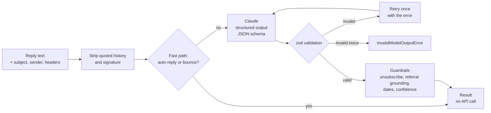

# reply-triage

Triage replies to outbound sales emails with Claude. Given a reply (and optionally its subject, sender and the email it answers), `reply-triage` returns one validated JSON object: what kind of reply it is, a one-sentence summary, a follow-up date if the person named one, the contact they pointed you to, whether a person should look at it, and a short draft answer. Quoted history and signatures are stripped before anything is sent. Obvious auto-replies and bounces are classified locally without an API call. Opt-outs always come back as `unsubscribe`, with no draft reply. It ships as a TypeScript library, a CLI and a small HTTP endpoint, with an evaluation harness you can run against your own model settings.



## Categories

| Category | Meaning | Draft reply |
|---|---|---|
| `interested` | Positive, with a general next step ("send me more", "let's try it") | yes |
| `question` | Asks something specific about the offer (pricing, integrations, security) | yes |
| `meeting_request` | Asks for or agrees to a call or demo, proposes times, shares a booking link | yes |
| `not_now` | Declines for now but leaves the door open, usually with a timing reason | yes |
| `not_interested` | Declines with no opening for later, however politely | yes |
| `unsubscribe` | Asks to stop being emailed or to be removed from a list | **never** |
| `referral` | Points you to a different person as the right contact | yes |
| `auto_reply` | Out-of-office, leave notice, ticket acknowledgement | **never** |
| `bounce` | Delivery failure notification | **never** |
| `other` | Anything else: left the company with no successor named, wrong person, bare "thanks" | yes |

When several apply, the precedence is `unsubscribe > bounce > auto_reply > referral > meeting_request > question > interested > not_now > not_interested > other`.

### Output

| Field | Type | Notes |
|---|---|---|
| `category` | one of the above | |
| `confidence` | number, 0 to 1 | The model's own estimate. Below 0.6, `needs_human` is forced to `true`. |
| `summary` | string | One sentence. |
| `follow_up_date` | `YYYY-MM-DD` or `null` | Only when the reply names a time ("ask me in March"), resolved against the reply date. |
| `referral` | `{ name, email }` or `null` | Only values that literally appear in the reply; either part may be `null`. |
| `needs_human` | boolean | Always `false` for `unsubscribe`, `auto_reply`, `bounce`. |
| `suggested_reply` | string or `null` | Short, polite, no invented commitments. `null` for `unsubscribe`, `auto_reply`, `bounce`. |
| `meta` | object | Where the result came from (`fast_path`, `model`, `refusal`), the model used, attempts, which guardrails fired, cleaning info and token usage. |

## Quick start

Requires Node.js 22+.

```bash
git clone https://github.com/bluedragonteam/reply-triage.git
cd reply-triage
npm install
npm run build

# Fast path: no API key needed
echo "Back on Monday." | node dist/bin.js --subject "Out of Office: hello"

# Anything else calls Claude
export ANTHROPIC_API_KEY=sk-ant-...
node dist/bin.js --file examples/reply.txt --original examples/outbound.txt
```

The second command sends only the new text of `examples/reply.txt` to the model. Quoted text and the signature are removed first, and `meta.cleaning` in the output shows that they were.

## Usage

### Library

```ts
import { triage, createTriager } from "reply-triage";

const result = await triage({
  reply: rawBody,                  // plain text body, quotes and signature included is fine
  subject: "Re: Shift scheduling",
  from: "Sam Reyes <sam@example.com>",
  originalEmail: outboundBody,     // optional context
  headers: { "Auto-Submitted": "no" }, // optional, enables the header fast path
  receivedAt: "2026-11-02",        // optional, used to resolve "ask me in March"
});

if (result.category === "unsubscribe") suppress(result);
else if (result.needs_human) queueForReview(result);

// For many replies, bind options once and reuse one client:
const run = createTriager({ effort: "low", lowConfidenceThreshold: 0.7 });
const results = await Promise.all(replies.map(run));
```

Errors are typed. `InvalidInputError` is thrown for bad input or a reply over the length limit; long replies are rejected, not truncated. `InvalidModelOutputError` is thrown when two attempts in a row fail validation. Anthropic SDK errors (`Anthropic.RateLimitError` and others) propagate after the SDK's own retries on 429, 5xx and connection errors.

Options (`TriageOptions`): `client`, `model`, `effort`, `fallbacks`, `fastPath`, `lowConfidenceThreshold`, `maxReplyChars`, `maxTokens`, `env`.

### CLI

```bash
reply-triage < reply.txt
reply-triage --file reply.txt --subject "Re: hello" --from "ana@example.com"
reply-triage --file reply.txt -H "Auto-Submitted: auto-replied" --compact
reply-triage --help
```

Run it from a clone with `node dist/bin.js`, or with `npx reply-triage` once the package is installed. JSON goes to stdout and errors to stderr. Exit codes: `0` success, `1` triage failed, `2` usage error.

### HTTP

```bash
npm run serve          # tsx, from source
# or: npm run build && npm start
```

```bash
curl -s localhost:8787/triage \
  -H 'content-type: application/json' \
  -d '{"reply": "Can we do a call Thursday at 2pm?", "subject": "Re: hello"}'
```

- `POST /triage` takes the same fields as the library (`reply`, `subject`, `from`, `originalEmail`, `headers`, `receivedAt`). Unknown fields are rejected.
- `GET /healthz` returns `{"ok": true}`.
- Bodies larger than 64 KiB get `413`. Other responses: `415` for a non-JSON content type, `400` for invalid input, `502` when the model output fails validation or the upstream API errors, `503` when rate limited.
- The server binds to `127.0.0.1` by default and **has no authentication**. Put it behind your own gateway before exposing it.

`createTriageServer({ triage, maxBodyBytes })` is exported if you want to mount it in your own process.

### Configuration

| Variable | Default | |
|---|---|---|
| `ANTHROPIC_API_KEY` | none | Read by the Anthropic SDK. |
| `REPLY_TRIAGE_MODEL` | `claude-opus-5-5` | Any current Claude model ID. |
| `REPLY_TRIAGE_EFFORT` | `low` | `low`, `medium`, `high`, `xhigh`, `max`. |
| `REPLY_TRIAGE_FALLBACKS` | `default` | `off` disables server-side refusal fallbacks. |
| `PORT` / `HOST` | `8787` / `127.0.0.1` | HTTP server only. |

See [`.env.example`](.env.example).

## Evaluation

`eval/dataset.jsonl` has 45 short replies written by hand for this project. They are synthetic: the names and companies are made up and every address uses the reserved `example.com/.org/.net` domains. Every category is covered, along with the cases that tend to go wrong:

- a polite "no" (`not_interested`) next to a polite "not this year, check back" (`not_now`)
- opt-outs with no "unsubscribe" keyword ("would you mind taking me off your mailing list?", "kindly leave me out of any future sends")
- an opt-out that also names a colleague (must be `unsubscribe`, not `referral`)
- a "not for me, but talk to our COO" reply (`referral`)
- an enthusiastic reply whose actual ask is a pricing question (`question`)
- someone who copies a colleague but stays the contact (`interested`, not `referral`)
- auto-replies and bounces both with headers or subjects (fast path) and without any metadata (model)
- quoted Gmail and Outlook history, signatures, a mobile footer and a German question

Each row has the expected category. Some rows also carry field checks: a follow-up date must be present, an exact date (`2027-01-15`), or a referral email must be extracted. All rows use a fixed reply date (2026-11-02) and a shared outbound email ([`eval/outbound.txt`](eval/outbound.txt)), so runs can be compared with each other.

```bash
export ANTHROPIC_API_KEY=sk-ant-...
npm run eval
npm run eval -- --effort medium            # compare effort levels
npm run eval -- --model claude-sonnet-5-5  # compare models
npm run eval -- --no-fast-path             # send every row to the model
npm run eval -- --limit 10 --concurrency 2
```

The runner prints each row, then overall accuracy, macro-F1, per-category precision/recall/F1, a confusion matrix, the field checks, the number of fast-path rows and total token usage. It writes a markdown report and the raw per-row results to `eval/results/` (git-ignored). A run makes up to one API call per non-fast-path row, plus one for each retry.

No results are published here on purpose. Accuracy on 45 replies written by the same people who wrote the prompt says little about your own inbox. Use the harness to compare settings, and add replies from your own traffic (anonymised) to the dataset before you rely on the numbers.

## Design notes

**Structured output instead of free-form JSON.** The request uses `output_config.format` with a JSON schema, so the response is constrained to the expected shape: the right keys, a valid `category`, nulls where allowed. zod then checks what a JSON schema can't express here: the confidence range, real ISO dates, valid email addresses and length limits. If that check fails, the request is retried once with the validation error included. If the retry fails too, an error is raised and no result is guessed. Forced tool calls are not used: on current models structured output is the supported way to get JSON back, and forced `tool_choice` is rejected by some of them.

**Guardrails after the model.** Some rules are cheap to check in code and too costly to get wrong, so they are not left to the model:

- An explicit opt-out phrase ("unsubscribe", "remove me from your list", "stop emailing me", "do not contact me again") forces `unsubscribe`, whatever category the model chose. It also clears `suggested_reply`, `follow_up_date` and `needs_human`: the address should be suppressed right away, not wait in a review queue. Simple negations are respected ("no need to unsubscribe me").
- A referral name or email that does not literally appear in the reply is dropped, so a guessed address never reaches your CRM. A `referral` left with no contact is sent to a human.
- A follow-up date in the past, or more than two years out, is dropped.
- Low confidence sets `needs_human`.

Every guardrail that changes a result is listed in `meta.guardrails`, so you can see when the model and the rules disagree.

**Treating reply text as untrusted.** Replies are written by third parties. They go into delimited tags, any delimiter tags inside them are neutralised, and the system prompt tells the model to treat that content as data. The guardrails above hold even if a reply manages to steer the model.

**Cost control.**
- *Fast path.* `Auto-Submitted` (RFC 3834), `X-Autoreply`, `Precedence: auto_reply`, out-of-office subjects, `multipart/report` delivery reports, `X-Failed-Recipients`, `MAILER-DAEMON`/`postmaster` senders and standard bounce subjects are all classified locally. Replies like these are common in outreach traffic, and handling them this way costs nothing.
- *Cleaning.* Quoted threads are often longer than the reply itself. Stripping them cuts input tokens and stops the model from classifying your own pitch.
- *Prompt caching.* The system prompt (category definitions, rules, examples) is static, with no dates or IDs, and carries a `cache_control` breakpoint. Everything that varies (the reply date, the reply, the outbound email) goes in the user message, so repeated requests can read the prefix from cache. Check `meta.usage.cache_read_input_tokens` to confirm hits.
- *Effort.* The default is `low`. Classification is a short, well-specified task, and the model still uses adaptive thinking when a reply needs it. Use the eval to decide whether `medium` is worth it for your traffic.
- `max_tokens` is 4096: enough for thinking plus the JSON, with a cap on runaway output.

**Model choice.** The default is `claude-opus-5-5`, Anthropic's current recommended default model. Override it with `REPLY_TRIAGE_MODEL` or the `model` option, and use `npm run eval -- --model …` to check whether a smaller model holds up on your data before switching.

**Refusals.** With the default model the request opts into server-side refusal fallbacks (`fallbacks: "default"`), so a false-positive safety decline is retried on a fallback model instead of failing. Set `REPLY_TRIAGE_FALLBACKS=off` to disable this. It is never sent to Haiku models, which do not support it. If the reply is still declined, the result is `other` with `needs_human: true` and `meta.source: "refusal"`. No category is invented.

## Limitations

- **The cleaning heuristics are line-based.** They cover common Gmail, Apple Mail and Outlook layouts and a few other languages. Unusual clients, HTML-only mail converted badly, or replies typed inside the quoted text can leave leftovers in or cut too much out. When cleaning would leave nothing, the original text is used instead.
- **Plain text only.** There is no MIME, HTML or `.eml` parsing. Pass the decoded text body and, if you have them, the headers.
- **The unsubscribe override is keyword-based.** It catches explicit phrasings in English. Indirect or non-English opt-outs rely on the model. Its only negation handling looks a few words back.
- **Unsubscribe is not a data-erasure workflow.** A GDPR deletion request is classified as `unsubscribe` with `needs_human: false`, as the rules require. Erasing the data is a separate process this tool does not start.
- **Follow-up dates are as good as the reply.** "Next summer" or "renewal time" may resolve to a date or to `null`. Only the past / more-than-two-years check is enforced.
- **Confidence is self-reported** and not calibrated. Treat the threshold as a routing knob, not a probability.
- **The eval set is small and synthetic.** See [Evaluation](#evaluation).
- **The HTTP server has no auth or rate limiting.**

## Development

```bash
npm install
npm run typecheck   # tsc over src, tests and eval
npm test            # vitest; no API key needed, the Anthropic client is mocked
npm run build       # emits dist/
```

The unit tests cover quote and signature stripping, the fast-path rules, every guardrail, output parsing and validation, the retry on invalid or truncated output, refusal handling, request shape (structured output, caching breakpoint, fallbacks, effort), CLI argument handling and exit codes, HTTP status codes and the size limit, and the metrics code. They also check that the eval dataset is well-formed. CI runs typecheck, tests and build on Node 22 without secrets.

Layout:

```
src/
  classifier.ts   triage(): clean → fast path → Claude → validate/retry → guardrails
  clean.ts        quote and signature stripping
  fastPath.ts     auto-reply and bounce rules
  guardrails.ts   unsubscribe override, referral grounding, date/confidence checks
  prompt.ts       system prompt, JSON schema, user message builder
  types.ts        zod schemas and types
  cli.ts, bin.ts  CLI
  server.ts, serve.ts  HTTP endpoint
eval/
  dataset.jsonl   45 synthetic labelled replies
  run.ts          eval runner (npm run eval)
  metrics.ts      accuracy, precision/recall, confusion matrix
test/             vitest unit tests
```

## License

[MIT](LICENSE) © 2026 Blue Dragon Team
